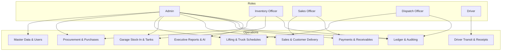

# CJP Southern Star OPC — Operations and System Guide

> **Document Type:** Operational & Architecture Specification  
> **Target Audience:** System Proponents, Operational Officers, Administrators, and Technical Auditors  
> **System Name:** CJP Southern Star OPC Inventory and Sales Monitoring System  
> **Implementation Stack:** Laravel 12, MySQL/SQLite, Vite, Chart.js, Vanilla/Tailwind CSS  
> **Status:** Verified Active Implementation  

---

## 1. MASTER PROCESS FLOW

The CJP Southern Star OPC system connects fuel procurement, hauling logistics, storage tank monitoring, customer order fulfillment, and cash flow tracking in an unbroken audit chain.

### Core End-to-End Operational Pipeline

```text
1. PURCHASE (Procurement from Depot)
   │
   ▼
2. FUEL LIFTING (Dispatch Scheduling & Driver Hauling)
   │
   ▼
3. WITHDRAWAL RECEIPT (Proof of Loading from Depot)
   │
   ▼
4. STOCK-IN (Verified Physical Delivery to Garage Storage Tank)
   │
   ▼
5. INVENTORY & LEDGER (Real-Time Tank Volume & Reconciliation)
   │
   ▼
6. SALE (Customer Sales Order Creation & Confirmation)
   │
   ▼
7. DELIVERY STATUS (Pending → Out for Delivery → Delivered)
   │
   ▼
8. STOCK-OUT (Automated Fuel Release from Garage Tank upon Delivery)
   │
   ▼
9. PAYMENT & RECEIVABLE (Cash/Cheque/Bank Collection & Balance Settlement)
   │
   ▼
10. REPORTS & ANALYTICS (Executive Dashboard, Variance, and Profit Tracking)
```

### Parallel & Supporting Workflows

```text
[Dispatch & Driver Logistics]
Dispatch Officer → Selects Unlifted Purchases → Validates Truck Capacity → Assigns Driver
→ Driver Departed (in_transit) → Driver Loaded at Depot (lifted) → Driver Uploads Withdrawal Receipt
→ Haul Marked Completed

[Garage Tank Storage]
Physical Tankers Arrive at Subic Garage → Inventory Officer Verifies Liters & Temperature
→ Selects Dedicated Tank (Diesel, F1, Premium, Unleaded) → Writes Inward Inventory Movement
→ Real-time Tank Levels Updated

[User & Role Management]
User Self-Registration → Role Selected (Driver, Dispatch, Inventory, Sales) → Status = Pending
→ Admin Reviews Account Request → Approves/Rejects → User Granted Role-Guarded Access
```

---

## 2. CJP DICTIONARY

| Term | Meaning | Trigger | Result |
|---|---|---|---|
| **Purchase** | A procurement contract ordering bulk fuel from an external depot. | Inventory Officer or Admin submits "+ Record Purchases". | Stored in `purchases` & `purchase_items`; status starts as `ordered` / `pending`. |
| **Purchase ID** | System-generated unique identifier (`PUR-YYMMDD-XXXXX`). | Purchase submission. | Authoritative procurement reference code. |
| **Depot** | External supply refinery/terminal (e.g., Subic, Batangas). | Master data setup or purchase entry. | Source origin for all purchased bulk fuel. |
| **Fuel Lifting** | The logistics operation of picking up purchased fuel from a depot using a company truck. | Dispatch Officer creates schedule. | Recorded in `hauls` and `haul_allocations` with code `LFT-YYMMDD-XXXXX`. |
| **Schedule Lift** | Allocating unlifted purchase liters to a truck, driver, and destination. | Dispatch Officer clicks "+ Schedule Lift". | Validates truck capacity and sets haul status to `scheduled`. |
| **Withdrawal Receipt** | Physical paper ticket/invoice issued by the depot upon tanker loading. | Driver uploads image/document on mobile portal. | Saved to private storage; linked to `hauls.withdrawal_receipt_path`. |
| **Garage** | The central CJP storage and depot facility in Subic. | Physical delivery arrival. | Holds active fuel storage tanks. |
| **Storage Location / Tank** | Dedicated calibrated tank in the garage holding one active fuel type. | Stock-in assignment. | Increases stock level via inward inventory movement. |
| **Stock-In** | Formal recording of physically delivered fuel into a garage tank. | Inventory Officer confirms haul receipt and assigns tank. | Creates `inventory_movements` (`stock_in`, `in`); updates allocation status to `garage_received`. |
| **Inventory** | Live balance of fuel currently stored across active garage tanks. | Any stock-in, stock-out, or manual correction. | Calculated dynamically: `SUM(in) - SUM(out)`. |
| **Ledger** | Chronological and mathematical audit trail of fuel purchases, lifts, receipts, and releases. | Daily operations. | Provides reconciled balances: Purchased vs Lifted vs In-Tank vs Sold. |
| **Transaction** | Any individual inward or outward movement of fuel stock. | Stock-in or stock-out release. | Immutably stored in `inventory_movements`. |
| **Sale** | Commercial order placed by a customer for bulk fuel. | Sales Officer or Admin submits "+ Record Sale". | Stored in `sales` and `sale_items`; generates receivable balance. |
| **Sales Order Number / Order ID** | System-generated commercial sales code (`ORD-YYMMDD-XXXXX` / `SLS-YYMMDD-XXXXX`). | Sale creation. | Primary customer billing and delivery tracking number. |
| **Delivery Status** | Life-cycle state of a sale fulfillment (`pending`, `out_for_delivery`, `delivered`, `cancelled`). | Sales Officer or Admin updates delivery modal. | Controls exact timing of inventory deduction. |
| **Delivered** | Confirmation that fuel has been pumped into customer facility. | Delivery marked `delivered`. | Atomically releases fuel from garage tank via `StockOutReleaseService`. |
| **Stock-Out** | Physical deduction and fulfillment of fuel from a tank or direct depot allocation to a customer. | Sale marked `delivered`. | Records `stock_outs` (`released`) and outward `inventory_movements` (`stock_out`, `out`). |
| **Direct Allocation** | Hauling fuel straight from supplier depot to a customer site without storing in garage. | Lift scheduled with destination `customer`. | Directly fulfilled upon haul completion; bypasses garage tank. |
| **Payment** | Inward remittance of money from customer (Cash, Cheque, Bank Transfer). | Sales Officer records payment against sale. | Reduces outstanding receivable balance; recorded in `payments`. |
| **Payment Method** | Mode of financial settlement (Cash, Cheque, Bank Transfer). | Selected at sale or payment time. | Validated; Cheque/Bank requires reference number. |
| **Receivable** | Uncollected debt owed by customer on a confirmed sale. | Sale creation. | Dynamically tracked in `receivables`: `Total Sale - Total Payments`. |
| **Installment** | Staged payment installment plan with sequence, due dates, and partial amounts. | Defined during sales order creation. | Tracked in `payment_schedules` (`pending`, `partial`, `paid`). |
| **Cost / Unit** | Purchase acquisition price per liter paid to depot. | Set on purchase item. | Basis for Cost of Goods Sold (COGS). |
| **Price / Unit** | Selling price per liter charged to customer. | Set on sale item. | Basis for Gross Revenue. |
| **Total Cost** | Total purchase outlay (`Liters × Cost/Unit`). | Auto-calculated server-side. | Tracked in procurement and inventory valuation. |
| **Total Paid** | Cumulative cash collected on a sale (`SUM(payments.amount)`). | Payment recording. | Compared against total price to close receivable. |
| **Profit** | Gross margin on sold fuel (`Total Price - Total Cost`). | Realized upon delivery. | Displayed in Stock-Out, Reports, and Executive Dashboard. |
| **AI Insights** | Automated artificial intelligence decision support for demand forecasting, sales trends, and financial risk analysis. | Admin requests AI analysis or opens dashboard. | Synthesizes sanitized operational metrics into executive commentary, trend projections, and inventory reorder recommendations (`ai_insights`). |

---

## 3. ROLE PROCESS MAP

The system enforces Role-Based Access Control (RBAC) across five distinct operational roles.



### Detailed Role Matrix & RBAC Restrictions

| Role | Module | Allowed Actions | Result | RBAC Restriction |
|---|---|---|---|---|
| **Admin** | User Management | Approve/reject accounts, edit staff, activate/deactivate users. | Controls system access. | Only Admin can access `/admin/user-management` and `/admin/account-requests`. |
| **Admin** | Trucks & Master Data | Add/edit trucks, toggle maintenance status, manage depots. | Controls fleet and depots. | Other roles cannot create trucks or alter fleet capacity. |
| **Admin** | Full Monitoring | View all modules, audit sales cancellations, run AI insights. | High-level business oversight. | Full access across all guarded routes. |
| **Inventory Officer** | Purchases | Record new purchases, edit unlifted purchases, cancel unlifted lines. | Creates procurement orders. | Cannot schedule trucks, record payments, or approve users. |
| **Inventory Officer** | Stock-In | Assign arrived hauls to garage tanks, post verified liters. | Increases garage tank stock. | Can only assign tanks matching the exact fuel type. |
| **Inventory Officer** | Depots & Ledger | Create depots, review procurement vs lifting ledger. | Reconciles fuel volume. | Cannot view or modify customer payment receivables. |
| **Dispatch Officer** | Fuel Lifting | Schedule hauls, assign trucks and drivers, validate capacity. | Creates driver trip manifests. | Cannot alter purchase costs, post stock-in, or create sales. |
| **Dispatch Officer** | Trucks | View fleet status, update truck operational readiness. | Prevents scheduling broken trucks. | Cannot modify user accounts or customer records. |
| **Dispatch Officer** | Ledger | View procurement vs lifting reconciliation. | Monitors unlifted purchase balance. | Cannot view sales pricing, costs, or company profits. |
| **Driver** | My Lifting Schedule | View assigned trips, update status (`in_transit`, `lifted`). | Informs dispatch of trip progress. | Can only view hauls explicitly assigned to own user ID. |
| **Driver** | Withdrawal Receipt | Upload photo/document of depot loading ticket. | Attaches legal proof of loading. | Cannot edit scheduled volume, change truck, or alter status backwards. |
| **Sales Officer** | Customers | Add new customers, update credit limits and contacts. | Maintains commercial accounts. | Cannot access garage tank assignments or dispatch fleet. |
| **Sales Officer** | Sales & Orders | Record sales, set installments, update delivery status. | Creates commercial transactions. | Cannot release stock-out without marking delivery `delivered`. |
| **Sales Officer** | Payments | Record payments, enter cheque/banking references. | Decreases customer receivable. | Cannot accept payment exceeding outstanding balance. |

---

## 4. STEP-BY-STEP OPERATIONS

### Operation: Add Purchase
**Purpose:** Record bulk fuel procured from a supply depot.
**Steps:**
1. Log in as Inventory Officer or Admin; open **Inventory** module (`/inventory-officer/inventory`).
2. Click **+ Record Purchases**.
3. Select **Purchase Date**, **Fuel Type** (Diesel, F1, Premium, Unleaded), **Depot**, **Quantity (Liters)**, and **Cost / Liter**.
4. Submit the form.
**Expected Result:** Purchase created with code `PUR-YYMMDD-XXXXX`; appears in Purchases tab and Stock-In Pipeline; alert dispatched to Dispatch Officer.
**Data Updated:** `purchases`, `purchase_items`, `alerts`.

---

### Operation: Schedule Lift
**Purpose:** Assign a truck and driver to pick up purchased fuel from a depot.
**Steps:**
1. Log in as Dispatch Officer; navigate to **Fuel Lifting** (`/dispatch/fuel-lifting`).
2. Click **+ Schedule Lift**.
3. Select an unlifted **Purchase Item** (filtered by depot).
4. Enter **Liters to Lift** (must be $\le$ remaining unlifted liters).
5. Choose destination: **Garage Allocation** (Tank) or **Customer Allocation** (Direct).
6. Select **Truck** (capacity must be $\ge$ total liters) and an approved **Driver**.
7. Pick **Scheduled Date** and submit.
**Expected Result:** Haul record generated (`LFT-YYMMDD-XXXXX`); status set to `scheduled`; purchase unlifted balance decreases; trip appears on Driver portal.
**Data Updated:** `hauls`, `haul_allocations`, `alerts`.

---

### Operation: Assign Truck / Driver
**Purpose:** Reassign or designate truck and driver for an existing scheduled haul.
**Steps:**
1. In Dispatch or Admin **Fuel Lifting** schedule view, locate the scheduled haul.
2. Click **Assign Truck** or **Edit**.
3. Select new available Truck and active Driver.
4. Submit changes.
**Expected Result:** Haul assignment updated; truck capacity constraints re-verified.
**Data Updated:** `hauls.truck_id`, `hauls.driver_user_id`.

---

### Operation: Driver Lift Process
**Purpose:** Advance physical hauling status from depot pickup to transit.
**Steps:**
1. Driver logs in and views **My Lifting Schedule** (`/driver/fuel-lifting`).
2. Upon departure to depot, click **Update** and select `In Transit`.
3. Upon loading fuel at the depot, click **Update** and select `Lifted`.
**Expected Result:** Real-time haul status updates on Dispatch and Admin boards.
**Data Updated:** `hauls.status` (`scheduled` $\rightarrow$ `in_transit` $\rightarrow$ `lifted`).

---

### Operation: Upload Withdrawal Receipt
**Purpose:** Attach proof-of-withdrawal paperwork issued by the supplier depot.
**Steps:**
1. In Driver portal, locate the lifted haul card.
2. Under "Depot Withdrawal Receipt", select image or PDF file ($\le$ 5MB).
3. Click **Upload**.
**Expected Result:** File saved to secure storage (`storage/app/private/withdrawal_receipts`); thumbnail/link available to Admin and Inventory Officer.
**Data Updated:** `hauls.withdrawal_receipt_path`.

---

### Operation: Stock-In
**Purpose:** Record verified bulk fuel arriving at the Subic garage into a calibrated storage tank.
**Steps:**
1. Log in as Inventory Officer; open **Inventory** $\rightarrow$ **Stock-In** tab.
2. Locate the arrived haul under "Pending Receipts Require Tank Assignment".
3. Click **Assign Tank**.
4. Verify received liters and timestamp.
5. Select destination **Garage Tank** (must match fuel type).
6. Submit the receipt.
**Expected Result:** Haul allocation marked `garage_received`; `inventory_movements` inward entry written; physical tank stock increases; purchase status transitions to `completed`.
**Data Updated:** `haul_allocations`, `inventory_movements`, `purchases.workflow_status`.

---

### Operation: Inventory & Garage Tanks Monitoring
**Purpose:** Inspect current fuel stock levels, capacity limits, and variance.
**Steps:**
1. Open **Inventory** (`/inventory-officer/inventory` or `/admin/inventory`).
2. Inspect top metric cards: Total Stock, Purchases, Releases.
3. Review storage tank table showing capacity, current volume, and fuel assignment across tanks.
**Expected Result:** Real-time visibility of physical fuel inventory across all 8 active tanks.
**Data Updated:** Read-only calculation from `inventory_movements`.

---

### Operation: Ledger & Transactions Review
**Purpose:** Audit fuel reconciliation and individual stock movements.
**Steps:**
1. Navigate to **Ledger** (`/admin/ledger`, `/inventory-officer/ledger`, or `/dispatch/ledger`).
2. Filter by Fuel Type, Date, or Depot.
3. Review procurement reconciliation: Ordered vs Hauled vs Garage Received vs Direct.
4. Switch to **Transactions** tab to audit movement codes, timestamps, and balance-after-transaction.
**Expected Result:** Complete mathematical balance matching physical operations.
**Data Updated:** Read-only reconciliation view.

---

### Operation: Record Sale
**Purpose:** Create a customer sales order for bulk fuel.
**Steps:**
1. Log in as Sales Officer; open **Sales** module (`/sales-officer/sales`).
2. Click **+ Record Sale**.
3. Select **Customer**, **Sale Date**, and **Payment Method**.
4. Add line items: **Fuel Type**, **Quantity (L)**, and **Price / Liter**.
5. Optionally specify installment plan or initial payment amount.
6. Submit the form.
**Expected Result:** Sale created with order code `ORD-YYMMDD-XXXXX`; line totals calculated; `delivery_status` set to `pending`; receivable opened.
**Data Updated:** `sales`, `sale_items`, `receivables`, `payment_schedules` (if staged).

---

### Operation: Delivery Status Update
**Purpose:** Track dispatch of sold fuel to customer and trigger inventory deduction upon delivery.
**Steps:**
1. In Sales module, locate the confirmed sale.
2. When tanker departs garage, click **Update Delivery** and select `Out for Delivery`.
3. When customer signs delivery note, select `Delivered`.
**Expected Result:** Status changes to `delivered`; system automatically calls `StockOutReleaseService`; validates garage tank stock; creates `stock_outs` (`released`); deducts fuel via `inventory_movements`.
**Data Updated:** `sales.delivery_status`, `sales.delivered_at`, `stock_outs`, `inventory_movements`.

---

### Operation: Stock-Out (Fulfillment)
**Purpose:** Physically release fuel from storage tank or completed depot haul to satisfy a sale.
**Steps:**
- **Automated:** Occurs immediately when Sale Delivery Status is marked `Delivered`.
- **Manual (Direct Allocation):** In Inventory module, select completed direct haul and link to sale item.
**Expected Result:** Fuel deducted from garage tank (or direct allocation consumed); sale item fulfilled quantity incremented.
**Data Updated:** `stock_outs`, `inventory_movements`, `sale_items.fulfilled_quantity_liters`.

---

### Operation: Record Payment
**Purpose:** Record customer remittances against outstanding receivables.
**Steps:**
1. On the Sales table, click **Record Payment** on a sale row.
2. View authoritative current balance (overpayment rejected).
3. Enter **Amount Paid**, **Payment Date**, and **Payment Method** (Cash, Cheque, Bank Transfer).
4. Enter reference number if Cheque or Bank Transfer.
5. If installment plan exists, designate specific schedule.
6. Submit payment.
**Expected Result:** `payments` record stored; receivable balance reduces; status updates (`open` $\rightarrow$ `partial` $\rightarrow$ `clear`).
**Data Updated:** `payments`, `receivables`.

---

### Operation: Receivables & Installments Monitoring
**Purpose:** Monitor aging customer accounts and installment compliance.
**Steps:**
1. In Sales module, open the **Receivables** tab.
2. Filter by status: `unpaid`, `partially_paid`, `overdue`, `settled`.
3. Click **Payment History** on any sale to inspect installments, due dates, paid amounts, and balances.
**Expected Result:** Clear audit trail of receivables and payment receipts.
**Data Updated:** Read-only calculation view.


### Operation: Reports & Executive Analytics
**Purpose:** Generate management reports on revenue, fuel volume, COGS, and profits.
**Steps:**
1. Log in as Admin; open **Reports** (`/admin/reports`).
2. Select Date Range, Depot, Customer, or Fuel Type filter.
3. Review aggregated sales, volume, gross profit, and collection rate.
4. Click **Export** for CSV data download.
5. Click **Generate Summary** for AI-prepared business and revenue summaries.
**Expected Result:** Reconciled financial analytics and printable audit reports.
**Data Updated:** `report_runs`.

---

### Operation: AI Insights & Demand Forecasting
**Purpose:** Generate AI-assisted executive demand forecasting, sales trend analysis, revenue collection projections, and inventory reorder recommendations.
**Steps:**
1. Log in as Admin; open **AI Insights / Analytics** (`/admin/insights` or `/admin/reports`).
2. Select desired analysis timeframe (30, 60, or 90 days) and scope.
3. System aggregates sanitized operational metrics via `AIDataPreparationService`.
4. Click **Generate AI Summary / Forecast**.
5. System queries configured AI engines (`BusinessInsightService`, `SalesTrendSummaryService`, `RevenueInsightService`, `InventoryVarianceExplanationService`), utilizing deterministic fallbacks if offline.
**Expected Result:** Executive commentary cards, seasonal trend commentary, variance root cause explanations, and reorder recommendations rendered on screen.
**Data Updated:** `ai_insights`, `report_runs`.

---

### Operation: Alerts Management
**Purpose:** Acknowledge and resolve operational notifications.
**Steps:**
1. Click the **Alerts** navigation link or bell icon.
2. Review unread operational alerts (new purchases, unassigned hauls, low stock warnings).
3. Click **Mark as Read** to acknowledge.
**Expected Result:** Alert marked as read; notification badge count decrements.
**Data Updated:** `alerts.is_read`, `alerts.read_at`.

---

## 5. END-TO-END TEST FLOW

This test path verifies the complete operational loop across all five roles.

| Step | Action | Expected Result | Data Change | Pass/Fail Check |
|---|---|---|---|---|
| **1. Purchase** | Inventory Officer orders 10,000 L of Diesel at PHP 50.00/L from Subic Depot. | Purchase created with code `PUR-XXXXX`; total PHP 500,000.00; status `ordered`. | `purchases` +1, `purchase_items` +1 | Purchase code visible in table; total matches math. |
| **2. Lift Schedule** | Dispatch Officer schedules 10,000 L of `PUR-XXXXX` to Truck-01 and Driver John. | Haul created with code `LFT-XXXXX`; status `scheduled`. | `hauls` +1, `haul_allocations` +1 | Haul visible in Dispatch and Driver portals. |
| **3. Driver Transit** | Driver logs in and marks haul `in_transit`. | Haul status updates to `in_transit`. | `hauls.status = 'in_transit'` | Status badge shows orange In Transit. |
| **4. Driver Lifted** | Driver marks haul `lifted` and uploads withdrawal receipt photo. | Haul status becomes `lifted`; receipt path stored. | `hauls.status = 'lifted'`, `withdrawal_receipt_path` set | Receipt link viewable by Admin and Inventory Officer. |
| **5. Stock-In** | Inventory Officer assigns Tank-01 (Diesel) and confirms 10,000 L received. | Stock-in recorded; physical tank stock increases by 10,000 L; purchase marked `completed`. | `inventory_movements` +1 (`in`), `purchases.workflow_status = 'completed'` | Diesel Tank-01 volume increases by 10,000 L on Inventory dashboard. |
| **6. Ledger Audit** | Check Ledger module. | Reconciled volume shows 10,000 L purchased, 10,000 L lifted, 10,000 L in garage. | Read-only reconciliation | Remaining unlifted liters = 0.00 L. |
| **7. Sale** | Sales Officer creates sale for Customer ABC: 5,000 L Diesel at PHP 60.00/L (Total PHP 300,000.00). | Sale created (`ORD-XXXXX`); `delivery_status = 'pending'`; receivable opened for PHP 300,000.00. | `sales` +1, `sale_items` +1, `receivables` +1 | Sale visible on Sales board; no inventory deducted yet. |
| **8. Delivery Transit** | Sales Officer marks sale `out_for_delivery`. | Sale delivery status updates to `out_for_delivery`. | `sales.delivery_status = 'out_for_delivery'` | Delivery status pill updates to Out for Delivery. |
| **9. Delivered & Stock-Out** | Sales Officer marks sale `delivered`. | System releases stock from Diesel Tank-01; creates stock-out and outward movement; Tank-01 drops to 5,000 L. | `stock_outs` +1 (`released`), `inventory_movements` +1 (`out`, 5,000 L) | Inventory decreases by exactly 5,000 L; profit recorded as PHP 50,000.00. |
| **10. Payment** | Sales Officer records partial payment of PHP 200,000.00 via Bank Transfer (Ref #BT12345). | Payment stored; receivable balance reduces to PHP 100,000.00; status becomes `partially_paid`. | `payments` +1, `receivables.status = 'partial'` | Receivable balance reflects PHP 100,000.00 remaining. |
| **11. Final Payment** | Sales Officer records remaining PHP 100,000.00 Cash payment. | Receivable balance becomes PHP 0.00; status transitions to `clear`. | `payments` +1, `receivables.status = 'clear'` | Sale status marked `paid`; receivable shows green Settled badge. |
| **12. Reports** | Admin views Sales & Financial Reports. | Report aggregates PHP 300,000.00 gross sales, PHP 250,000.00 COGS, PHP 50,000.00 profit, 100% collection. | `report_runs` logged | Dashboard numbers match all transactional movements. |

---

## 6. SYSTEM VERIFICATION CHECKLIST

Use this checklist during manual or automated quality assurance reviews.

- [ ] **Forms**
  - [ ] Idempotency tokens prevent duplicate submissions on double-clicking.
  - [ ] Numeric inputs enforce positive values (`min="0.01"`).
  - [ ] Dates default to current date or valid operational ranges.
  - [ ] Dropdowns populate only active, approved master records.
- [ ] **Buttons**
  - [ ] Action buttons (`View`, `Edit`, `Cancel`, `Assign`) correctly open designated modals.
  - [ ] Destructive actions (`Cancel Sale`, `Deactivate User`) request user confirmation.
  - [ ] Disabled states trigger when prerequisites are missing (e.g., zero balance disables payment).
- [ ] **Database Updates**
  - [ ] All multi-table writes execute inside atomic transactions (`DB::transaction`).
  - [ ] Primary keys auto-increment safely; business codes follow standardized formats.
  - [ ] Foreign keys cascade or restrict appropriately.
- [ ] **Inventory & Tanks**
  - [ ] Stock-In requires verified haul allocation and matching fuel tank.
  - [ ] Over-capacity tank deliveries are flagged.
  - [ ] Real-time current stock strictly equals inward movements minus outward movements.
  - [ ] Negative inventory balances are strictly prevented by database locks.
- [ ] **Lifting & Hauling**
  - [ ] Scheduled liters cannot exceed remaining unlifted purchase balance.
  - [ ] Total haul liters cannot exceed truck rated capacity.
  - [ ] Drivers can only access and update trips assigned to their own user record.
- [ ] **Sales & Fulfillment**
  - [ ] Sale line totals and grand totals calculate server-side.
  - [ ] Sale creation does NOT deduct physical inventory.
  - [ ] Changing delivery status to `Delivered` automatically and atomically creates Stock-Out.
  - [ ] Delivered sales cannot be reverted or silently altered.
- [ ] **Payments & Receivables**
  - [ ] Overpayment beyond sale balance is rejected.
  - [ ] Cheque and Bank Transfer require reference codes.
  - [ ] Full payment automatically transitions receivable to `clear`.
- [ ] **Security & RBAC**
  - [ ] Unauthenticated requests redirect to `/login`.
  - [ ] Unapproved registered users are blocked with pending approval notice.
  - [ ] Role middleware rejects unauthorized cross-role access (e.g., Driver accessing `/admin`).
  - [ ] Depot withdrawal receipts are served only through authenticated guarded routes.
- [ ] **Alerts & Reports**
  - [ ] Purchase, lift, and delivery milestones write operational alerts.
  - [ ] Reports export valid, uncorrupted CSV data.
  - [ ] AI services fail gracefully without exposing API keys or crashing the UI.

---

## 7. MANUSCRIPT COMPLIANCE

Evaluation of the production codebase against the original Proponents' Manuscript and System Analysis specifications.

| Requirement / Specification | Status | Evaluation Notes |
|---|---|---|
| **Role-Based Authentication (5 Roles)** | ✅ IMPLEMENTED | Admin, Inventory Officer, Sales Officer, Dispatch Officer, and Driver are fully implemented with route middleware and approval gating. |
| **Separate Roles Table** | ⚠️ PARTIAL | Manuscript specified a normalized `roles` table. The implementation uses a robust `users.role` enum + middleware. This is functionally equivalent and faster, but differs in database schema design. |
| **Fuel Catalog (Diesel, F1, Premium, Unleaded)** | ✅ IMPLEMENTED | Fixed active master catalog enforced across procurement, storage tanks, lifting, sales, and analytics. |
| **Purchasing & Procurement Tracking** | ✅ IMPLEMENTED | Full procurement headers and line items, depot linking, cost tracking, and automatic purchase code generation. |
| **Procurement & Stock-In Pipeline** | ✅ IMPLEMENTED | Fully realized procurement-to-stock-in workflow. Accurately stages bulk purchases through lifting and hauling logistics, verifying and recording physical fuel into calibrated garage storage tanks via `StockInService` upon delivery arrival, preventing ghost inventory. |
| **Fuel Lifting & Dispatch Scheduling** | ✅ IMPLEMENTED | Multi-purchase haul scheduling, truck capacity checking, driver assignment, and depot origin tracking are fully realized. |
| **Truck Master Data & Fleet Management** | ✅ IMPLEMENTED | Trucks have plate numbers, models, capacities, operational statuses, and conflict checking. |
| **Fixed 40,000 L Truck Capacity** | ➖ NOT APPLICABLE | Manuscript suggested all trucks are 40,000 L. Implemented with dynamic `trucks.capacity_liters` so the company can operate diverse tanker sizes (e.g., 20KL, 30KL, 40KL). |
| **Mobile Driver Portal & Withdrawal Receipts** | ✅ IMPLEMENTED | Drivers have a responsive portal to accept trips, update transit milestones, and upload physical depot loading receipts to private guarded storage. |
| **Calibrated Garage Tank Inventory** | ✅ IMPLEMENTED | Two physical tanks per fuel type (8 active tanks total) with calibrated capacity, fuel validation, and real-time inventory ledger movements. |
| **Sales Order Management** | ✅ IMPLEMENTED | Complete customer order placement, order codes, line item pricing, and credit tracking. |
| **Standalone Deliveries Table** | ⚠️ PARTIAL | Manuscript proposed a standalone `deliveries` table. The system architected an integrated `sales.delivery_status` lifecycle (`pending` $\rightarrow$ `out_for_delivery` $\rightarrow$ `delivered`) and direct/garage `stock_outs`. This eliminates data synchronization bugs between sales and delivery records. |
| **Sale-Triggered Stock-Out Timing** | ✅ IMPLEMENTED | Stock-out is strictly held until delivery status reaches `Delivered`, preventing phantom inventory drops before customer receipt. |
| **Direct Depot-to-Customer Deliveries** | ✅ IMPLEMENTED | Supports direct customer allocation from depot hauls, bypassing garage tanks without contaminating physical garage ledger balances. |
| **Payments & Receivables Aging** | ✅ IMPLEMENTED | Partial and full payment tracking, cash/cheque/bank support, reference validation, and automatic receivable status closure. |
| **Installment Payment Schedules** | ✅ IMPLEMENTED | Flexible `payment_schedules` system fully supporting the manuscript's 4-installment schedule as well as custom commercial intervals (1–12+ terms) with automated status reconciliation (`clear`, `partial`, `pending`, `overdue`) and balance tracking. |
| **Ledger & Audit Logging** | ✅ IMPLEMENTED | Immutable `inventory_movements` ledger tracking every liter in and out with running balances. |
| **Predictive Analytics & AI Forecasting** | ✅ IMPLEMENTED | Multi-engine generative AI integration (`AIService`, `BusinessInsightService`, `SalesTrendSummaryService`, `RevenueInsightService`, `InventoryVarianceExplanationService`) supporting Groq and Gemini LLMs with automatic deterministic mathematical fallbacks, token caching, and strict credential protection. Fully satisfies forecasting and decision-support requirements without external service failure risks. |
| **Frontend Stack (Bootstrap/jQuery)** | ➖ NOT APPLICABLE | Manuscript proposed Bootstrap and jQuery. The project upgraded to modern Laravel Blade, Tailwind/Vanilla CSS, Vite, and Chart.js for superior speed, security, and responsive mobile behavior. |
| **Security & OWASP Compliance** | ✅ IMPLEMENTED | CSRF protection, rate limiting, SQL injection defense via PDO binding, private storage authorization, and secure session management. |

---

## 8. GRAPHIFY SUMMARY

Machine-friendly relational mapping representing verified entities and actions in the CJP codebase:

```text
User → registers → AccountRequest
Admin → approves → User
User → authenticates → Session

Depot → supplies → Purchase
Purchase → contains → PurchaseItem
Purchase → generates → WorkflowAlert

PurchaseItem → scheduled_by → Haul
Truck → assigned_to → Haul
Driver → assigned_to → Haul
Haul → split_into → HaulAllocation
Driver → updates → HaulStatus
Driver → uploads → WithdrawalReceipt

HaulAllocation → allocated_to → StorageLocation
HaulAllocation → direct_recipient → Customer
HaulAllocation → posted_as → StockIn
StockIn → creates → InventoryMovement
InventoryMovement → increases → StorageLocation
InventoryMovement → updates → Ledger

Customer → places → Sale
Sale → contains → SaleItem
Sale → tracks → Receivable
Sale → has → PaymentSchedule
Sale → has → DeliveryStatus

DeliveryStatus → updated_to → Delivered
DeliveredSale → triggers → StockOutRelease
StockOutRelease → fulfills → SaleItem
StockOutRelease → creates → StockOut
StockOut → creates → InventoryMovement
InventoryMovement → decreases → StorageLocation

Customer → remits → Payment
Payment → credits → Sale
Payment → settles → PaymentSchedule
Payment → reduces → Receivable
Receivable → closes_at → ZeroBalance

InventoryMovement → feeds → ReportRun
Sale → aggregated_in → ReportRun
ReportRun → generates → AIInsight
```
